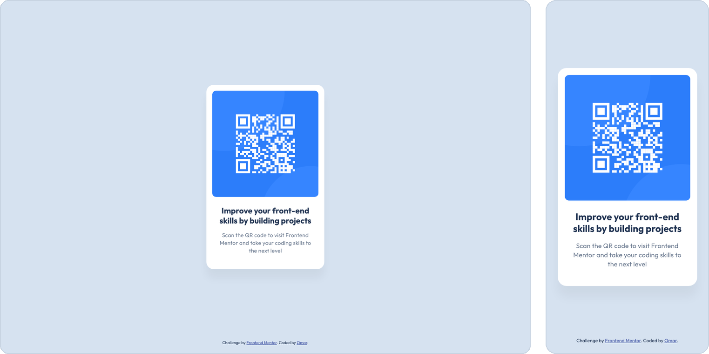

<h1 align="center">QR code component</h1>

<p align="center">
  <b>A simple QR code card, built with HTML and CSS from a Frontend Mentor design.</b>
</p>

<p align="center">
  
</p>

<p align="center">
  <a href="https://gloomyygl.github.io/QR-code-component/"><b>Live demo</b></a> ·
  <a href="https://www.frontendmentor.io/challenges/qr-code-component-iux_sIO_H">Challenge</a>
</p>

---

## Description

This is my solution to the [QR code component challenge](https://www.frontendmentor.io/challenges/qr-code-component-iux_sIO_H) on Frontend Mentor.

The goal was to build the card so it looks as close to the design as possible. The card shows a QR code that links to Frontend Mentor, with a short heading and text below it. It sits in the middle of the screen on both mobile and desktop.

## Features

- **Matches the design** – built to the mobile (375px) and desktop (1440px) designs
- **Responsive** – works on screens from 320px wide up to large monitors
- **Always centered** – the card stays in the middle of the screen, with the credit line at the bottom
- **Semantic HTML** – uses `main`, `article`, `h1` and `p`, with alt text on the QR code image
- **Easy to change** – all colors and font sizes are saved as CSS variables

## Built with

- **HTML** – structure of the card
- **CSS** – design and layout with CSS variables, Grid and Flexbox (font: [Outfit](https://fonts.google.com/specimen/Outfit))

No frameworks or libraries are used.

## Project structure

```
qr-code-component/
├── index.html        # The card
├── css/
│   └── style.css     # Design and layout
├── images/           # QR code, favicon and the picture in this README
├── LICENSE
└── README.md
```

## Acknowledgments

Challenge by [Frontend Mentor](https://www.frontendmentor.io?ref=challenge).

## License

This project is licensed under the [MIT License](LICENSE).
